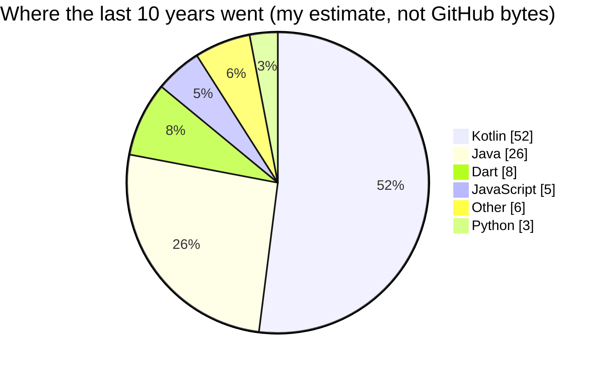

[**singgihsaputro.github.io**](https://singgihsaputro.github.io) &nbsp;·&nbsp;
[LinkedIn](https://www.linkedin.com/in/singgihrs/) &nbsp;·&nbsp;
[singgih.rochmad@gmail.com](mailto:singgih.rochmad@gmail.com)

## About

Senior Android Engineer with **10 years** building consumer and merchant apps at
Indonesia's largest technology companies, including products with **100M+ downloads**.
Recent focus on server-driven UI, anti-fraud and KYC integration, and app size and
performance optimization. I lead cross-team delivery and mentor senior engineers.

| | | |
|---|---|---|
| **10 yrs** building Android | **100M+** downloads on apps shipped | **1st / 74** GoTo Hackathon 2025 |

## Tech Stack

**Mobile**

      

**Architecture & Libraries**

    

**Backend & Web**

    

## Language mix

Most of this lives in private repositories, so this account's public language stats
do not tell the story — they are dominated by vendored files in old web projects.

## Shipped

| App | Reach | Stack |
|---|---|---|
| [GoFood Merchant (GoBiz)](https://play.google.com/store/apps/details?id=com.gojek.resto) | 5M+ · 4.1★ | Kotlin, Jetpack Compose, MVVM/MVI, multi-module, Room, Retrofit |
| [Gojek](https://play.google.com/store/apps/details?id=com.gojek.app) | 100M+ · 4.7★ | Kotlin, Jetpack Compose, clean architecture, coroutines, Flow |
| [GoPay](https://play.google.com/store/apps/details?id=com.gojek.gopay) | 100M+ · 4.7★ | Flutter, Dart, MVVM, multi-module, clean architecture |
| [TIX ID](https://play.google.com/store/apps/details?id=id.tix.android) | 10M+ · 4.8★ | Kotlin, Java, Room, RxJava2, Dagger2, MVP |
| [DANA](https://play.google.com/store/apps/details?id=id.dana) | 100M+ · 4.7★ | Java, Room, RxJava2, Dagger2, Retrofit, MVP |
| PayPro | Indosat, white-label | Java, RxJava, Dagger2, Retrofit, MVP |

## Highlighted projects

<!-- RECENT:START -->

| Project | What it is | Language |
|---|---|---|
| [erp](https://github.com/singgihsaputro/erp) | ERP for Indonesian retail and distribution SMEs, one feature a night | TypeScript |
| [pokemon-kotlin-multiplatform-mobile](https://github.com/singgihsaputro/pokemon-kotlin-multiplatform-mobile) | Kotlin Multiplatform sample sharing business logic across Android and iOS | Kotlin |
| [android-pomodoro-timer](https://github.com/singgihsaputro/android-pomodoro-timer) | A single-screen Android Pomodoro timer: pick a preset, run alternating focus/break countdowns, and track completed sessions. | Kotlin |
| [ios-habit-tracker](https://github.com/singgihsaputro/ios-habit-tracker) | A single-screen SwiftUI habit tracker with streaks and mock data | Swift |
| [backend-expense-splitter](https://github.com/singgihsaputro/backend-expense-splitter) | A Go backend that splits shared group expenses and computes minimal settlements | Go |
| [WebChat-BottlePython](https://github.com/singgihsaputro/WebChat-BottlePython) ⭐2 | Web chat built on Bottle, Python’s micro web framework | Python |

<!-- RECENT:END -->

## All repositories

<!-- ALL:START -->

83 public repositories, grouped and refreshed every day. 46 of them are mini projects a scheduled agent built one a night; the newest, [erp](https://github.com/singgihsaputro/erp), grows by a feature a night.

<b>Projects</b> · 11

| Project | What it is | Language | Year |
|---|---|---|---|
| [erp](https://github.com/singgihsaputro/erp) | ERP for Indonesian retail and distribution SMEs, one feature a night | TypeScript | 2026 |
| [smart-worksheet](https://github.com/singgihsaputro/smart-worksheet) | Smart Worksheet by childplay — free, ad-free learning games and talking flash cards for young children, in the browser (Bahasa Indonesia) | JavaScript | 2026 |
| [kids-activity-books](https://github.com/singgihsaputro/kids-activity-books) | Printable activity books for ages 1-5, one folder per book | Python | 2026 |
| [quran-reciter](https://github.com/singgihsaputro/quran-reciter) | Ayok Ngaji — a free, ad-free Qur'an reciting game for children: it listens, lights up every word and gives stars. Hijaiyah flash cards and bedtime stories too. | HTML | 2026 |
| [kotlin-dsa](https://github.com/singgihsaputro/kotlin-dsa) | Data structures and algorithms in Kotlin — ten interview problems with reasoning, complexity analysis and 47 tests | Kotlin | 2026 |
| [daily-projects](https://github.com/singgihsaputro/daily-projects) | A small app a night, built by a scheduled cloud agent — Android, iOS, backend, web | Kotlin | 2026 |
| [singgihsaputro.github.io](https://github.com/singgihsaputro/singgihsaputro.github.io) ⭐1 | Personal CV landing page — Next.js static export + Tailwind, deployed to GitHub Pages | JavaScript | 2026 |
| [weekly-checklist](https://github.com/singgihsaputro/weekly-checklist) | Weekly checklist app — React + Vite frontend, Express + SQLite backend, single process in production | JavaScript | 2026 |
| [pokemon-kotlin-multiplatform-mobile](https://github.com/singgihsaputro/pokemon-kotlin-multiplatform-mobile) | Sample repo implmeen Kotlin Multiplatform for Mobile (Android/iOS | Kotlin | 2026 |
| [scrapper](https://github.com/singgihsaputro/scrapper) | — | — | 2024 |
| [recycler-view-demo](https://github.com/singgihsaputro/recycler-view-demo) | — | — | 2023 |

<b>Android apps</b> · 9 · built one a night by a scheduled agent

| Project | What it is | Language | Year |
|---|---|---|---|
| [android-flashcards](https://github.com/singgihsaputro/android-flashcards) | Android flashcard trainer in Jetpack Compose with a requeue-on-miss study loop | Kotlin | 2026 |
| [android-budget-envelopes](https://github.com/singgihsaputro/android-budget-envelopes) | Android envelope budgeting app (Compose, mock data) | Kotlin | 2026 |
| [android-caffeine-tracker](https://github.com/singgihsaputro/android-caffeine-tracker) | Android app that estimates active caffeine and sleep-safe time (Compose, mock data) | Kotlin | 2026 |
| [android-habit-streaks](https://github.com/singgihsaputro/android-habit-streaks) | Android habit tracker with streaks and a 7-day check-in strip (Compose, mock data) | Kotlin | 2026 |
| [android-countdown](https://github.com/singgihsaputro/android-countdown) | Android countdown timer app: live countdowns to upcoming events (Compose, Material 3) | Kotlin | 2026 |
| [android-qr-generator](https://github.com/singgihsaputro/android-qr-generator) | A single-screen Android app that turns typed text or a URL into a scannable QR code, with presets and history | Kotlin | 2026 |
| [android-password-generator](https://github.com/singgihsaputro/android-password-generator) | Random password generator with strength meter and generation history, built with Kotlin and Jetpack Compose | Kotlin | 2026 |
| [android-water-intake-log](https://github.com/singgihsaputro/android-water-intake-log) | A single-screen Android app that logs drinks against a daily water goal, built with Jetpack Compose and Material 3. | Kotlin | 2026 |
| [android-pomodoro-timer](https://github.com/singgihsaputro/android-pomodoro-timer) | A single-screen Android Pomodoro timer: pick a preset, run alternating focus/break countdowns, and track completed sessions. | Kotlin | 2026 |

<b>Android libraries</b> · 5 · built one a night by a scheduled agent

| Project | What it is | Language | Year |
|---|---|---|---|
| [androidlib-compose-shimmer](https://github.com/singgihsaputro/androidlib-compose-shimmer) | Compose skeleton and shimmer loaders as an Android library | Kotlin | 2026 |
| [androidlib-pii-redaction-log](https://github.com/singgihsaputro/androidlib-pii-redaction-log) | Android logging wrapper that redacts PII (emails, phones, NIK, cards, tokens) before it hits logcat | Kotlin | 2026 |
| [androidlib-crash-breadcrumbs](https://github.com/singgihsaputro/androidlib-crash-breadcrumbs) | Android library: ring buffer of recent app events written alongside crash stack traces | Kotlin | 2026 |
| [androidlib-id-formatters](https://github.com/singgihsaputro/androidlib-id-formatters) | Kotlin library for Rupiah, phone number and NIK formatting/validation on Android | Kotlin | 2026 |
| [androidlib-retry-backoff](https://github.com/singgihsaputro/androidlib-retry-backoff) | Retry a suspending call or a Flow with exponential backoff and full jitter — Kotlin, coroutines, with a sample app | Kotlin | 2026 |

<b>iOS apps</b> · 7 · built one a night by a scheduled agent

| Project | What it is | Language | Year |
|---|---|---|---|
| [ios-plant-watering](https://github.com/singgihsaputro/ios-plant-watering) | SwiftUI plant watering schedule with overdue tracking | Swift | 2026 |
| [ios-mood-log](https://github.com/singgihsaputro/ios-mood-log) | SwiftUI mood journal with streaks and history (mock data) | Swift | 2026 |
| [ios-checklist](https://github.com/singgihsaputro/ios-checklist) | SwiftUI checklist app with progress tracking and mock starter lists | Swift | 2026 |
| [ios-tip-calculator](https://github.com/singgihsaputro/ios-tip-calculator) | SwiftUI tip calculator with per-country tipping suggestions and exact bill splitting | Swift | 2026 |
| [ios-sleep-log](https://github.com/singgihsaputro/ios-sleep-log) | A single-screen SwiftUI app for logging nightly sleep hours and quality with a mock weekly log | Swift | 2026 |
| [ios-packing-list](https://github.com/singgihsaputro/ios-packing-list) | A single-screen SwiftUI packing checklist, grouped by category with a progress bar | Swift | 2026 |
| [ios-habit-tracker](https://github.com/singgihsaputro/ios-habit-tracker) | A single-screen SwiftUI habit tracker with streaks and mock data | Swift | 2026 |

<b>Kotlin Multiplatform</b> · 8 · built one a night by a scheduled agent

| Project | What it is | Language | Year |
|---|---|---|---|
| [kmpfullstack-note-store](https://github.com/singgihsaputro/kmpfullstack-note-store) | Pinned-notes store: one Kotlin domain, Ktor server plus Android, web and iOS clients | Kotlin | 2026 |
| [kmpfullstack-habit-sync](https://github.com/singgihsaputro/kmpfullstack-habit-sync) | Habit tracker with Ktor server and shared Kotlin domain across Android, web and iOS | Kotlin | 2026 |
| [kmpfullstack-shopping-list](https://github.com/singgihsaputro/kmpfullstack-shopping-list) | Kotlin Multiplatform shared shopping list: Ktor API plus Android, web and iOS clients | Makefile | 2026 |
| [kmpfullstack-bookmark-store](https://github.com/singgihsaputro/kmpfullstack-bookmark-store) | Kotlin Multiplatform bookmark store: shared domain, Ktor API, Android, web and iOS clients | Kotlin | 2026 |
| [kmpfullstack-short-link-service](https://github.com/singgihsaputro/kmpfullstack-short-link-service) | A URL shortener built as one Kotlin Multiplatform repo — shared domain logic, a real Ktor server, and Android/iOS/web clients that all talk to it over HTTP. | Kotlin | 2026 |
| [kmp-grocery-list](https://github.com/singgihsaputro/kmp-grocery-list) | Kotlin Multiplatform grocery list — shared checklist logic driving a Jetpack Compose screen | Kotlin | 2026 |
| [kmp-unit-converter](https://github.com/singgihsaputro/kmp-unit-converter) | Kotlin Multiplatform unit converter (length/weight/volume) with a Compose Android UI, built on a shared conversion engine | Kotlin | 2026 |
| [kmp-reading-tracker](https://github.com/singgihsaputro/kmp-reading-tracker) | Kotlin Multiplatform reading tracker: shared Kotlin business logic, Compose Android UI, mock JSON fixture | Kotlin | 2026 |

<b>Web apps</b> · 6 · built one a night by a scheduled agent

| Project | What it is | Language | Year |
|---|---|---|---|
| [web-meeting-planner](https://github.com/singgihsaputro/web-meeting-planner) | Nuxt 4 meeting planner that finds shared working hours across time zones | Vue | 2026 |
| [web-meal-planner](https://github.com/singgihsaputro/web-meal-planner) | Vue 3 weekly meal planner with auto-merged shopping list | JavaScript | 2026 |
| [web-image-compressor](https://github.com/singgihsaputro/web-image-compressor) | Browser-side image compressor built with Vue 3, Vite and Tailwind v4 | Vue | 2026 |
| [web-markdown-scratchpad](https://github.com/singgihsaputro/web-markdown-scratchpad) | Vue 3 + Pinia two-pane Markdown scratchpad with live preview | JavaScript | 2026 |
| [web-receipt-scanner](https://github.com/singgihsaputro/web-receipt-scanner) | A Vue 3 receipt scanner that runs mock OCR on a picked receipt and lets you review/correct flagged low-confidence lines | Vue | 2026 |
| [web-currency-converter](https://github.com/singgihsaputro/web-currency-converter) | A single-screen React + Tailwind currency converter backed by mock exchange-rate fixtures | TypeScript | 2026 |

<b>Backends</b> · 6 · built one a night by a scheduled agent

| Project | What it is | Language | Year |
|---|---|---|---|
| [backend-packing-list](https://github.com/singgihsaputro/backend-packing-list) | TypeScript/Hono API that builds and tracks trip packing lists | TypeScript | 2026 |
| [backend-currency-converter](https://github.com/singgihsaputro/backend-currency-converter) | Go net/http currency converter API with mock rates behind a RateSource interface | Go | 2026 |
| [backend-sleep-log](https://github.com/singgihsaputro/backend-sleep-log) | Rust Axum API that logs nightly sleep and summarises duration, sleep debt and regularity | Rust | 2026 |
| [backend-reminder-api](https://github.com/singgihsaputro/backend-reminder-api) | FastAPI reminder service with overdue/due-soon queries | Python | 2026 |
| [backend-shift-planner](https://github.com/singgihsaputro/backend-shift-planner) | A TypeScript/Hono shift-scheduling API with role and overlap conflict checks | TypeScript | 2026 |
| [backend-expense-splitter](https://github.com/singgihsaputro/backend-expense-splitter) | A Go backend that splits shared group expenses and computes minimal settlements | Go | 2026 |

<b>Freelance web apps</b> · 5 · built one a night by a scheduled agent

| Project | What it is | Language | Year |
|---|---|---|---|
| [freelance-leave-tracker](https://github.com/singgihsaputro/freelance-leave-tracker) | Leave approval screen: queue, conflict warnings, team calendar, balances (React 19 + Tailwind v4) | TypeScript | 2026 |
| [freelance-mart-pos](https://github.com/singgihsaputro/freelance-mart-pos) | Vue 3 + Tailwind mini-mart point-of-sale with printable receipt | Vue | 2026 |
| [freelance-order-board](https://github.com/singgihsaputro/freelance-order-board) | React 19 + Tailwind v4 restaurant kitchen order board (mock data) | TypeScript | 2026 |
| [freelance-stock-alerts](https://github.com/singgihsaputro/freelance-stock-alerts) | Vue 3 + Tailwind stock screen with low-stock alerts and suggested reorder list | Vue | 2026 |
| [freelance-invoice-generator](https://github.com/singgihsaputro/freelance-invoice-generator) | React + jsPDF freelance invoice generator with client-side PDF export | TypeScript | 2026 |

<b>Flutter samples</b> · 6

| Project | What it is | Language | Year |
|---|---|---|---|
| [flutter_api_restaurant_sample](https://github.com/singgihsaputro/flutter_api_restaurant_sample) | — | Dart | 2024 |
| [flutter_animation_sample](https://github.com/singgihsaputro/flutter_animation_sample) | — | Dart | 2024 |
| [flutter_camera_sample](https://github.com/singgihsaputro/flutter_camera_sample) | Flutter project to simulate integrate camera function basic | Dart | 2023 |
| [flutter_maps_sample](https://github.com/singgihsaputro/flutter_maps_sample) | Demonstrate google maps integration | Dart | 2023 |
| [flutter_api_integration_sample](https://github.com/singgihsaputro/flutter_api_integration_sample) | Restaurant Mock Application built by using Flutter | Dart | 2023 |
| [flutter_statefull_stateless_sample](https://github.com/singgihsaputro/flutter_statefull_stateless_sample) | — | Dart | 2023 |

<b>Early work, 2016–2019</b> · 20

| Project | What it is | Language | Year |
|---|---|---|---|
| [DrinkReminder](https://github.com/singgihsaputro/DrinkReminder) | This is sample project which is implement kotlin language and instant app | — | 2017 |
| [SampleContactProvider](https://github.com/singgihsaputro/SampleContactProvider) | — | Java | 2017 |
| [DesignPattern-Java](https://github.com/singgihsaputro/DesignPattern-Java) | Sample Design Pattern in Java | Java | 2017 |
| [DesignPattern-Kotlin](https://github.com/singgihsaputro/DesignPattern-Kotlin) | Sample Design Pattern in Kotlin | Kotlin | 2017 |
| [SampleRxLoginForm](https://github.com/singgihsaputro/SampleRxLoginForm) | — | Java | 2016 |
| [SampleRxJava-RetroLambda](https://github.com/singgihsaputro/SampleRxJava-RetroLambda) | Sample RxJava with RetroLambda Java 8 | Java | 2016 |
| [SampleKotlin](https://github.com/singgihsaputro/SampleKotlin) | This is sample project Android Apps using Kotlin with Rx and Retrofit | Kotlin | 2016 |
| [SampleRxJava-Retrofit](https://github.com/singgihsaputro/SampleRxJava-Retrofit) ⭐1 | This project is just sample using RxJava and Retrofit | Java | 2016 |
| [SampleAuthFirebase-Android-](https://github.com/singgihsaputro/SampleAuthFirebase-Android-) | This is sample project auth using firebase on Android platform | Java | 2016 |
| [BasicLogic](https://github.com/singgihsaputro/BasicLogic) | This is sample code that solve about logic problem | Java | 2016 |
| [PopularMovies](https://github.com/singgihsaputro/PopularMovies) | This is android app that provide information about movie | Java | 2016 |
| [Chat-using-Phyton](https://github.com/singgihsaputro/Chat-using-Phyton) | Chat apps desktop using Phyton | Python | 2016 |
| [I_Pet](https://github.com/singgihsaputro/I_Pet) | Sample web apps with JQUery Mobile | CSS | 2016 |
| [OrangeFruitDetectionUsingBayes](https://github.com/singgihsaputro/OrangeFruitDetectionUsingBayes) ⭐1 | Orange detection image pattern using Bayes Theory | HTML | 2016 |
| [WebChat-BottlePython](https://github.com/singgihsaputro/WebChat-BottlePython) ⭐2 | Web Chat Sample using Bottle and Python | Python | 2016 |
| [Epharm](https://github.com/singgihsaputro/Epharm) | Project ERP about pharmacy sale | PHP | 2016 |
| [Evoting](https://github.com/singgihsaputro/Evoting) | Aplikasi prototype untuk memvoting calon wakil rakyat | JavaScript | 2016 |
| [Flash-Math](https://github.com/singgihsaputro/Flash-Math) | Mobile game education about math on android platform | Java | 2016 |
| [KumpulinSampah](https://github.com/singgihsaputro/KumpulinSampah) ⭐1 | Apps KumpulinSampah provide us to post, collect and buy rubbish | Java | 2016 |
| [Web-DSS-AHP](https://github.com/singgihsaputro/Web-DSS-AHP) ⭐2 | Project website decision support system AHP | JavaScript | 2016 |

<!-- ALL:END -->

## Experience

**Gojek (GoTo)** · Senior Software Engineer, Android · Nov 2019 – present

- Replaced release-gated layout changes with **server-driven UI** — campaigns now ship as configuration.
- Built a self-serve bank account flow with real-time FRS risk checks, removing **3,000 manual tickets a month**.
- Shipped a reusable feedback module that collected **56,290 responses** at 4.65/5.
- Led MVI adoption and the ViewBinding migration; split Help Center and Onboarding into separate modules.
- Cut **~10MB** off the APK through rebranding cleanup, POS build optimization and legacy removal.
- Onboarded 3 senior Android engineers; ran interview panels and sprint capacity planning.

**Kemendikbudristek** · Practitioner Lecturer · 2022 – 2025 — taught Android and Flutter at 5 universities.

**DANA** · Senior Software Engineer · Jul 2017 – Oct 2019 — led a 3-person offshore team on TIX ID,
integrated Alicloud CDN for ~20% better image load efficiency, mentored 2 engineers.

**Ice House** · Software Engineer · Oct 2016 – Jun 2017 — built PayPro end-to-end for Indosat.

## Awards

- **Champion, GoTo Hackathon 2025** — 1st of 74 teams across Indonesia, India, Singapore and China.
- 2nd Winner, Hackathon Google Indonesia Android Kejar (2016)
- 1st Winner, Inovasi Teknologi East Java, IT Category (2015)
- Winner, Mobile Apps Development Competition, Gadjah Mada University (2014)
- Finalist & Best Category, "World Citizenship" IDTECH, Microsoft (2014)

## Education

**University of Indonesia** — Master of Information Technology (2023 – 2026)

**Brawijaya University** — Bachelor of Computer Science (2011 – 2016)

## Stats

Open to senior and lead Android roles.
Full CV at [**singgihsaputro.github.io**](https://singgihsaputro.github.io).

