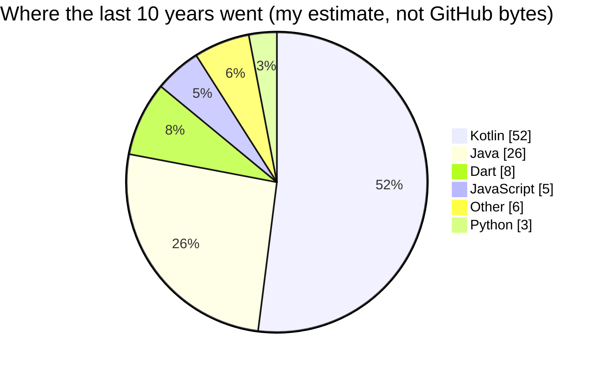

[**singgihsaputro.github.io**](https://singgihsaputro.github.io) &nbsp;·&nbsp;
[LinkedIn](https://www.linkedin.com/in/singgihrs/) &nbsp;·&nbsp;
[singgih.rochmad@gmail.com](mailto:singgih.rochmad@gmail.com)

## About

Senior Android Engineer with **10 years** building consumer and merchant apps at
Indonesia's largest technology companies, including products with **100M+ downloads**.
Recent focus on server-driven UI, anti-fraud and KYC integration, and app size and
performance optimization. I lead cross-team delivery and mentor senior engineers.

| | | |
|---|---|---|
| **10 yrs** building Android | **100M+** downloads on apps shipped | **1st / 74** GoTo Hackathon 2025 |

## Tech Stack

**Mobile**

      

**Architecture & Libraries**

    

**Backend & Web**

    

## Language mix

Most of this lives in private repositories, so this account's public language stats
do not tell the story — they are dominated by vendored files in old web projects.

## Shipped

| App | Reach | Stack |
|---|---|---|
| [GoFood Merchant (GoBiz)](https://play.google.com/store/apps/details?id=com.gojek.resto) | 5M+ · 4.1★ | Kotlin, Jetpack Compose, MVVM/MVI, multi-module, Room, Retrofit |
| [Gojek](https://play.google.com/store/apps/details?id=com.gojek.app) | 100M+ · 4.7★ | Kotlin, Jetpack Compose, clean architecture, coroutines, Flow |
| [GoPay](https://play.google.com/store/apps/details?id=com.gojek.gopay) | 100M+ · 4.7★ | Flutter, Dart, MVVM, multi-module, clean architecture |
| [TIX ID](https://play.google.com/store/apps/details?id=id.tix.android) | 10M+ · 4.8★ | Kotlin, Java, Room, RxJava2, Dagger2, MVP |
| [DANA](https://play.google.com/store/apps/details?id=id.dana) | 100M+ · 4.7★ | Java, Room, RxJava2, Dagger2, Retrofit, MVP |
| PayPro | Indosat, white-label | Java, RxJava, Dagger2, Retrofit, MVP |

## Highlighted projects

<!-- RECENT:START -->

| Project | What it is | Language |
|---|---|---|
| [erp](https://github.com/singgihsaputro/erp) | ERP for Indonesian retail and distribution SMEs, one feature a night | TypeScript |
| [pokemon-kotlin-multiplatform-mobile](https://github.com/singgihsaputro/pokemon-kotlin-multiplatform-mobile) | Kotlin Multiplatform sample sharing business logic across Android and iOS | Kotlin |
| [android-pomodoro-timer](https://github.com/singgihsaputro/android-pomodoro-timer) | A single-screen Android Pomodoro timer: pick a preset, run alternating focus/break countdowns, and track completed sessions. | Kotlin |
| [ios-habit-tracker](https://github.com/singgihsaputro/ios-habit-tracker) | A single-screen SwiftUI habit tracker with streaks and mock data | Swift |
| [backend-expense-splitter](https://github.com/singgihsaputro/backend-expense-splitter) | A Go backend that splits shared group expenses and computes minimal settlements | Go |
| [WebChat-BottlePython](https://github.com/singgihsaputro/WebChat-BottlePython) ⭐2 | Web chat built on Bottle, Python’s micro web framework | Python |

<!-- RECENT:END -->

## All repositories

<!-- ALL:START -->

82 public repositories, grouped and refreshed every day. 45 of them are mini projects a scheduled agent built one a night; the newest, [erp](https://github.com/singgihsaputro/erp), grows by a feature a night.

<b>Projects</b> · 11

| Project | What it is | Language | Year |
|---|---|---|---|
| [erp](https://github.com/singgihsaputro/erp) | ERP for Indonesian retail and distribution SMEs, one feature a night | TypeScript | 2026 |
| [daily-projects](https://github.com/singgihsaputro/daily-projects) | — | — | 2026 |
| [kids-activity-books](https://github.com/singgihsaputro/kids-activity-books) | Printable activity books for ages 1-5, one folder per book | — | 2026 |
| [smart-worksheet](https://github.com/singgihsaputro/smart-worksheet) | — | — | 2026 |
| [quran-reciter](https://github.com/singgihsaputro/quran-reciter) | — | — | 2026 |
| [singgihsaputro.github.io](https://github.com/singgihsaputro/singgihsaputro.github.io) | — | — | 2026 |
| [weekly-checklist](https://github.com/singgihsaputro/weekly-checklist) | — | — | 2026 |
| [kotlin-dsa](https://github.com/singgihsaputro/kotlin-dsa) | — | — | 2026 |
| [pokemon-kotlin-multiplatform-mobile](https://github.com/singgihsaputro/pokemon-kotlin-multiplatform-mobile) | — | Kotlin | 2026 |
| [scrapper](https://github.com/singgihsaputro/scrapper) | — | — | 2024 |
| [recycler-view-demo](https://github.com/singgihsaputro/recycler-view-demo) | — | — | 2023 |

<b>Android apps</b> · 8 · built one a night by a scheduled agent

| Project | What it is | Language | Year |
|---|---|---|---|
| [android-budget-envelopes](https://github.com/singgihsaputro/android-budget-envelopes) | An Android app that splits a month's budget into spending envelopes, shows how much is left in each, flags the ones that are nearly empty or overspent, and works out what you can safely spend per day. | Kotlin | 2026 |
| [android-caffeine-tracker](https://github.com/singgihsaputro/android-caffeine-tracker) | An Android app that logs your coffee, tea and energy drinks and estimates how much caffeine is still active in your body and when it will drop low enough for sleep. | Kotlin | 2026 |
| [android-habit-streaks](https://github.com/singgihsaputro/android-habit-streaks) | An Android app that lists your daily habits with current and best streaks, a seven-day dot strip per habit, and a one-tap check-in for today. | Kotlin | 2026 |
| [android-countdown](https://github.com/singgihsaputro/android-countdown) | An Android app that shows live days/hours/minutes/seconds countdowns to your upcoming events, with past events listed below. | Kotlin | 2026 |
| [android-qr-generator](https://github.com/singgihsaputro/android-qr-generator) | A single-screen Android app that turns typed text or a URL into a scannable QR code, offers a few starter presets, and keeps a reusable history of recent codes. | Kotlin | 2026 |
| [android-password-generator](https://github.com/singgihsaputro/android-password-generator) | A single-screen Android app that generates a random password from adjustable length and character-set options, rates its strength, and keeps a running history of what it generated. | Kotlin | 2026 |
| [android-water-intake-log](https://github.com/singgihsaputro/android-water-intake-log) | A single-screen Android app that logs drinks against a daily water goal and shows progress with a running total. | Kotlin | 2026 |
| [android-pomodoro-timer](https://github.com/singgihsaputro/android-pomodoro-timer) | A single-screen Android Pomodoro timer: pick a preset, run alternating focus/break countdowns, and track completed sessions. | Kotlin | 2026 |

<b>Android libraries</b> · 5 · built one a night by a scheduled agent

| Project | What it is | Language | Year |
|---|---|---|---|
| [androidlib-compose-shimmer](https://github.com/singgihsaputro/androidlib-compose-shimmer) | An Android library of Jetpack Compose skeleton loaders: a `shimmer()` modifier, a `skeleton()` placeholder modifier, and ready-made list-row placeholders. | Kotlin | 2026 |
| [androidlib-pii-redaction-log](https://github.com/singgihsaputro/androidlib-pii-redaction-log) | An Android logging wrapper that scrubs emails, Indonesian phone numbers, NIK, card numbers, tokens and `password=...` pairs from every message and stack trace before it reaches logcat (or any sink you plug in). | Kotlin | 2026 |
| [androidlib-crash-breadcrumbs](https://github.com/singgihsaputro/androidlib-crash-breadcrumbs) | An Android library that keeps a ring buffer of the last N things your app did and writes them next to the stack trace when the app crashes, so the next launch can show what the user did before it died. | Kotlin | 2026 |
| [androidlib-id-formatters](https://github.com/singgihsaputro/androidlib-id-formatters) | A dependency-free Kotlin library that formats and parses Rupiah, normalises Indonesian mobile numbers, and structurally validates NIK (national ID) numbers. | Kotlin | 2026 |
| [androidlib-retry-backoff](https://github.com/singgihsaputro/androidlib-retry-backoff) | Retry a suspending call or a `Flow` with exponential backoff and full jitter, in | Kotlin | 2026 |

<b>iOS apps</b> · 7 · built one a night by a scheduled agent

| Project | What it is | Language | Year |
|---|---|---|---|
| [ios-plant-watering](https://github.com/singgihsaputro/ios-plant-watering) | A single-screen SwiftUI app that lists your houseplants by urgency, shows which are overdue or due today, and lets you mark one watered with a tap. | Swift | 2026 |
| [ios-mood-log](https://github.com/singgihsaputro/ios-mood-log) | A single-screen SwiftUI app where you pick today's mood and a short note, and see your average, current streak, best day and history. | Swift | 2026 |
| [ios-checklist](https://github.com/singgihsaputro/ios-checklist) | A single-screen SwiftUI app that loads starter checklists (trip, moving day, leaving the house), lets you tick items off with a progress bar, and add, delete or reset items. | Swift | 2026 |
| [ios-tip-calculator](https://github.com/singgihsaputro/ios-tip-calculator) | A single-screen SwiftUI app that suggests a tip for the country you are eating in, then splits the total between diners down to the cent. | Swift | 2026 |
| [ios-sleep-log](https://github.com/singgihsaputro/ios-sleep-log) | A single-screen SwiftUI app that shows the last week of sleep as a bar-per-night log with an average, and lets you log tonight's hours and quality. | Swift | 2026 |
| [ios-packing-list](https://github.com/singgihsaputro/ios-packing-list) | A single-screen SwiftUI app that groups a trip's packing items by category (Clothing, Toiletries, Electronics, Documents) and lets you check each one off, with a progress bar showing how much is packed. | Swift | 2026 |
| [ios-habit-tracker](https://github.com/singgihsaputro/ios-habit-tracker) | A single-screen SwiftUI app that lists daily habits, shows each one's streak and last-7-day history, and lets you check it off for today. | Swift | 2026 |

<b>Kotlin Multiplatform</b> · 8 · built one a night by a scheduled agent

| Project | What it is | Language | Year |
|---|---|---|---|
| [kmpfullstack-note-store](https://github.com/singgihsaputro/kmpfullstack-note-store) | A pinned-notes app where every note lives on one Ktor server and shows up, with the same search and pin-first ordering, in the Android, web and iOS clients: one Kotlin domain in `shared/`, four front ends. | Kotlin | 2026 |
| [kmpfullstack-habit-sync](https://github.com/singgihsaputro/kmpfullstack-habit-sync) | A habit tracker where every check-in lives on one Ktor server and shows up, with the same streak maths, in the Android, web and iOS clients: one Kotlin domain in `shared/`, four front ends. | Kotlin | 2026 |
| [kmpfullstack-shopping-list](https://github.com/singgihsaputro/kmpfullstack-shopping-list) | A shopping list you can tick off, filter by aisle and clear once you are at the till: one Kotlin domain in `shared/`, a Ktor API in `server/`, and Android, web and iOS clients that all talk to it. | Kotlin | 2026 |
| [kmpfullstack-bookmark-store](https://github.com/singgihsaputro/kmpfullstack-bookmark-store) | A tagged bookmark manager with starring and deletion: one Kotlin domain in `shared/`, a Ktor API in `server/`, and Android, web and iOS clients that all talk to it. | Kotlin | 2026 |
| [kmpfullstack-short-link-service](https://github.com/singgihsaputro/kmpfullstack-short-link-service) | A URL shortener: paste a long URL to get a short code back, visiting `/r/<code>` redirects to the original URL and counts the click — with the model, validation, and short-code logic defined once in a Kotlin Multiplatform `shared` module and used by a real Ktor server plus three clients (Android, iOS, web) that all talk to it over HTTP. | Kotlin | 2026 |
| [kmp-grocery-list](https://github.com/singgihsaputro/kmp-grocery-list) | A Kotlin Multiplatform grocery list: adding items, checking them off, grouping by aisle category, and tracking cart progress all live in a `shared` module, with a Jetpack Compose screen on Android that lists the fixture grouped by category with a progress bar and an add-item row. | Kotlin | 2026 |
| [kmp-unit-converter](https://github.com/singgihsaputro/kmp-unit-converter) | A Kotlin Multiplatform unit converter: category selection, unit lookup, and the conversion math live in a `shared` module, with a Jetpack Compose screen on Android that lets you pick a category, choose From/To units, and see the live result. | Kotlin | 2026 |
| [kmp-reading-tracker](https://github.com/singgihsaputro/kmp-reading-tracker) | A Kotlin Multiplatform reading tracker: the book list, progress math, and state management live in a `shared` module, with a Jetpack Compose screen on Android that lists books, shows read-progress bars, and lets you log pages. | Kotlin | 2026 |

<b>Web apps</b> · 6 · built one a night by a scheduled agent

| Project | What it is | Language | Year |
|---|---|---|---|
| [web-meeting-planner](https://github.com/singgihsaputro/web-meeting-planner) | A Nuxt 4 single-page tool that lays cities' working hours side by side and highlights the hours when everyone is at work, so you can pick a meeting time. | Vue | 2026 |
| [web-meal-planner](https://github.com/singgihsaputro/web-meal-planner) | A Vue 3 page where you choose a dinner for each day of the week and get a merged shopping list and calorie total automatically. | JavaScript | 2026 |
| [web-image-compressor](https://github.com/singgihsaputro/web-image-compressor) | A browser tool that shrinks an image by re-encoding it as JPEG, WebP or PNG at a chosen quality and width, and shows the before/after file sizes side by side. | Vue | 2026 |
| [web-markdown-scratchpad](https://github.com/singgihsaputro/web-markdown-scratchpad) | A two-pane notes app: write Markdown on the left, see it rendered live on the right, with search and autosave. | JavaScript | 2026 |
| [web-receipt-scanner](https://github.com/singgihsaputro/web-receipt-scanner) | A single-screen Vue app that runs mock OCR on a picked receipt photo, itemizes it, flags low-confidence lines, and recalculates the total as you correct them. | Vue | 2026 |
| [web-currency-converter](https://github.com/singgihsaputro/web-currency-converter) | A single-screen React app that converts an amount between currencies using fixture exchange rates, with a full rate table shown below. | TypeScript | 2026 |

<b>Backends</b> · 6 · built one a night by a scheduled agent

| Project | What it is | Language | Year |
|---|---|---|---|
| [backend-packing-list](https://github.com/singgihsaputro/backend-packing-list) | A small TypeScript (Hono) backend that generates a packing list for a trip from a template, scaling clothes by trip length, and tracks what has been packed. | TypeScript | 2026 |
| [backend-currency-converter](https://github.com/singgihsaputro/backend-currency-converter) | A small Go HTTP API that converts amounts between currencies using a rate table read from a local fixture, rounding results to each currency's minor units. | Go | 2026 |
| [backend-sleep-log](https://github.com/singgihsaputro/backend-sleep-log) | A small Rust (Axum) service that records nightly sleep, computes duration across midnight, and summarises a window of nights with average sleep, sleep debt against an 8-hour goal, and bedtime regularity. | Rust | 2026 |
| [backend-reminder-api](https://github.com/singgihsaputro/backend-reminder-api) | A small FastAPI service for creating reminders, listing them by status (upcoming / overdue / done), and asking what is due in the next N hours. | Python | 2026 |
| [backend-shift-planner](https://github.com/singgihsaputro/backend-shift-planner) | A small TypeScript backend that manages a workplace shift schedule: list open shifts, assign an employee, and get rejected with a clear reason when the role doesn't match or the employee is already booked at that time. | TypeScript | 2026 |
| [backend-expense-splitter](https://github.com/singgihsaputro/backend-expense-splitter) | A small Go backend that tracks shared group expenses and tells you the minimal set of payments needed to settle up. | Go | 2026 |

<b>Freelance web apps</b> · 5 · built one a night by a scheduled agent

| Project | What it is | Language | Year |
|---|---|---|---|
| [freelance-leave-tracker](https://github.com/singgihsaputro/freelance-leave-tracker) | A manager's leave-approval screen: a queue of pending requests with balance and team-conflict warnings, a month calendar of who is off, and per-employee leave balances. | TypeScript | 2026 |
| [freelance-mart-pos](https://github.com/singgihsaputro/freelance-mart-pos) | A Vue 3 point-of-sale screen for a small mini-mart: tap or scan products into a cart, take cash with quick-cash buttons, and print an 80 mm receipt with PPN 11% and Rp 100 cash rounding. | Vue | 2026 |
| [freelance-order-board](https://github.com/singgihsaputro/freelance-order-board) | A React kitchen order board for a small restaurant: orders move across New → Preparing → Ready → Served columns with one tap, late tickets are flagged by age, and staff can search by table, order number or dish. | TypeScript | 2026 |
| [freelance-stock-alerts](https://github.com/singgihsaputro/freelance-stock-alerts) | A Vue 3 stock screen for a small shop: it flags low and out-of-stock items, lets staff sell, add or receive stock, and builds a suggested supplier reorder list with an estimated cost. | Vue | 2026 |
| [freelance-invoice-generator](https://github.com/singgihsaputro/freelance-invoice-generator) | A single-screen React app where a freelancer picks a client, edits line items, and downloads a formatted PDF invoice with tax and totals calculated automatically. | TypeScript | 2026 |

<b>Flutter samples</b> · 6

| Project | What it is | Language | Year |
|---|---|---|---|
| [flutter_api_restaurant_sample](https://github.com/singgihsaputro/flutter_api_restaurant_sample) | — | — | 2024 |
| [flutter_animation_sample](https://github.com/singgihsaputro/flutter_animation_sample) | — | — | 2024 |
| [flutter_camera_sample](https://github.com/singgihsaputro/flutter_camera_sample) | — | — | 2023 |
| [flutter_maps_sample](https://github.com/singgihsaputro/flutter_maps_sample) | — | — | 2023 |
| [flutter_api_integration_sample](https://github.com/singgihsaputro/flutter_api_integration_sample) | — | — | 2023 |
| [flutter_statefull_stateless_sample](https://github.com/singgihsaputro/flutter_statefull_stateless_sample) | — | — | 2023 |

<b>Early work, 2016–2019</b> · 20

| Project | What it is | Language | Year |
|---|---|---|---|
| [DesignPattern-Java](https://github.com/singgihsaputro/DesignPattern-Java) | — | — | 2018 |
| [DrinkReminder](https://github.com/singgihsaputro/DrinkReminder) | — | — | 2017 |
| [PopularMovies](https://github.com/singgihsaputro/PopularMovies) | — | — | 2017 |
| [SampleContactProvider](https://github.com/singgihsaputro/SampleContactProvider) | — | — | 2017 |
| [DesignPattern-Kotlin](https://github.com/singgihsaputro/DesignPattern-Kotlin) | — | — | 2017 |
| [SampleRxLoginForm](https://github.com/singgihsaputro/SampleRxLoginForm) | — | — | 2016 |
| [SampleRxJava-RetroLambda](https://github.com/singgihsaputro/SampleRxJava-RetroLambda) | — | — | 2016 |
| [SampleRxJava-Retrofit](https://github.com/singgihsaputro/SampleRxJava-Retrofit) | — | — | 2016 |
| [SampleKotlin](https://github.com/singgihsaputro/SampleKotlin) | — | — | 2016 |
| [SampleAuthFirebase-Android-](https://github.com/singgihsaputro/SampleAuthFirebase-Android-) | — | — | 2016 |
| [BasicLogic](https://github.com/singgihsaputro/BasicLogic) | — | — | 2016 |
| [Chat-using-Phyton](https://github.com/singgihsaputro/Chat-using-Phyton) | — | — | 2016 |
| [Epharm](https://github.com/singgihsaputro/Epharm) | — | — | 2016 |
| [Evoting](https://github.com/singgihsaputro/Evoting) | — | — | 2016 |
| [I_Pet](https://github.com/singgihsaputro/I_Pet) | — | — | 2016 |
| [OrangeFruitDetectionUsingBayes](https://github.com/singgihsaputro/OrangeFruitDetectionUsingBayes) | — | — | 2016 |
| [Web-DSS-AHP](https://github.com/singgihsaputro/Web-DSS-AHP) | — | — | 2016 |
| [WebChat-BottlePython](https://github.com/singgihsaputro/WebChat-BottlePython) ⭐2 | — | Python | 2016 |
| [KumpulinSampah](https://github.com/singgihsaputro/KumpulinSampah) | — | — | 2016 |
| [Flash-Math](https://github.com/singgihsaputro/Flash-Math) | — | — | 2016 |

<!-- ALL:END -->

## Experience

**Gojek (GoTo)** · Senior Software Engineer, Android · Nov 2019 – present

- Replaced release-gated layout changes with **server-driven UI** — campaigns now ship as configuration.
- Built a self-serve bank account flow with real-time FRS risk checks, removing **3,000 manual tickets a month**.
- Shipped a reusable feedback module that collected **56,290 responses** at 4.65/5.
- Led MVI adoption and the ViewBinding migration; split Help Center and Onboarding into separate modules.
- Cut **~10MB** off the APK through rebranding cleanup, POS build optimization and legacy removal.
- Onboarded 3 senior Android engineers; ran interview panels and sprint capacity planning.

**Kemendikbudristek** · Practitioner Lecturer · 2022 – 2025 — taught Android and Flutter at 5 universities.

**DANA** · Senior Software Engineer · Jul 2017 – Oct 2019 — led a 3-person offshore team on TIX ID,
integrated Alicloud CDN for ~20% better image load efficiency, mentored 2 engineers.

**Ice House** · Software Engineer · Oct 2016 – Jun 2017 — built PayPro end-to-end for Indosat.

## Awards

- **Champion, GoTo Hackathon 2025** — 1st of 74 teams across Indonesia, India, Singapore and China.
- 2nd Winner, Hackathon Google Indonesia Android Kejar (2016)
- 1st Winner, Inovasi Teknologi East Java, IT Category (2015)
- Winner, Mobile Apps Development Competition, Gadjah Mada University (2014)
- Finalist & Best Category, "World Citizenship" IDTECH, Microsoft (2014)

## Education

**University of Indonesia** — Master of Information Technology (2023 – 2026)

**Brawijaya University** — Bachelor of Computer Science (2011 – 2016)

## Stats

Open to senior and lead Android roles.
Full CV at [**singgihsaputro.github.io**](https://singgihsaputro.github.io).

